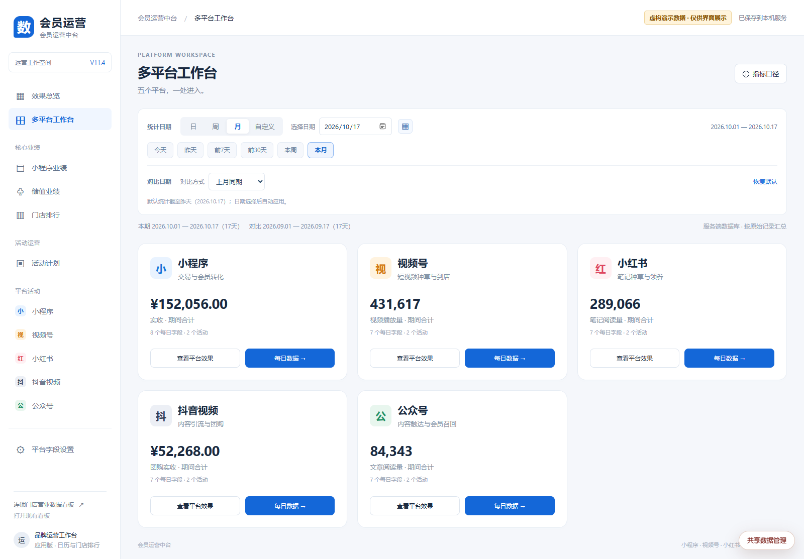
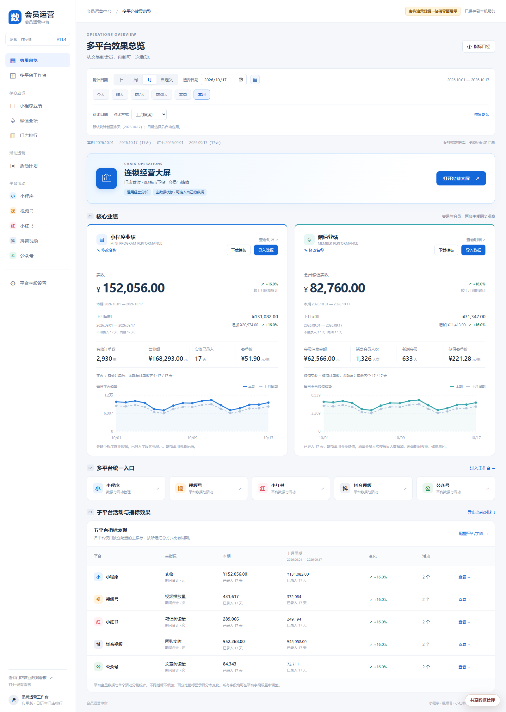
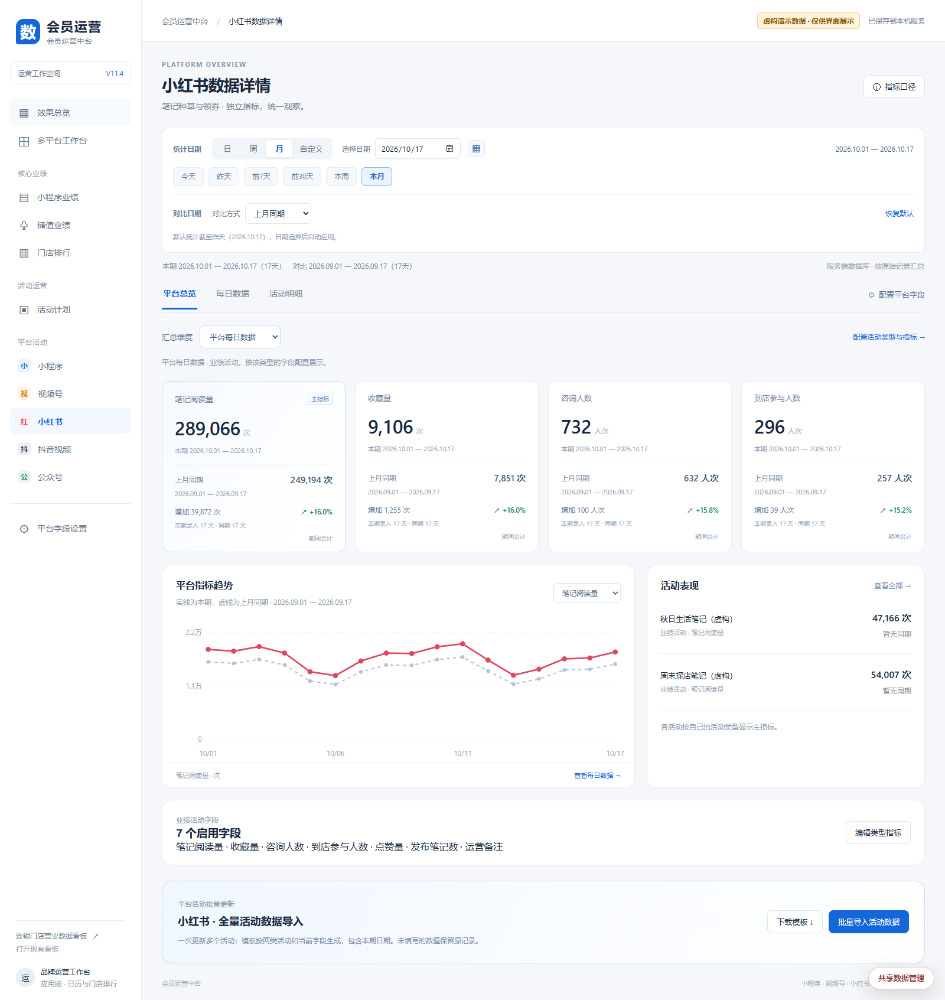
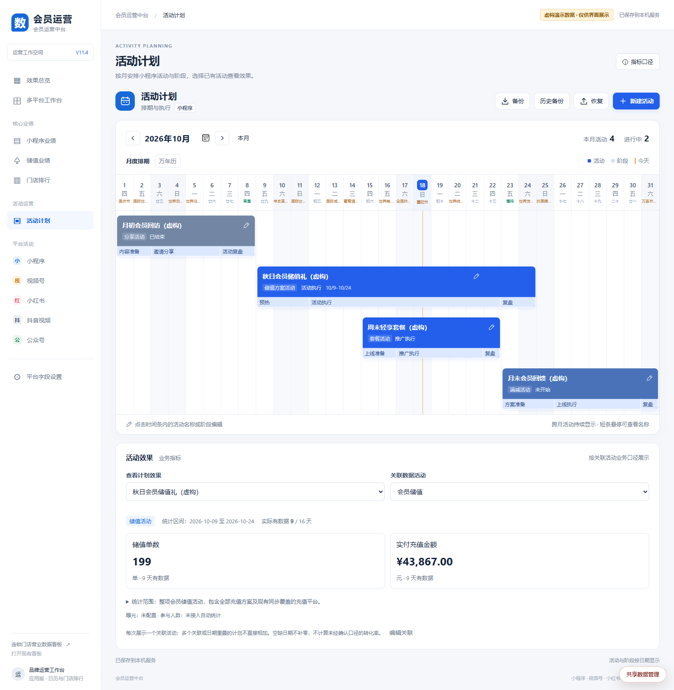

# 多平台会员运营数据看板

**Digital Dashboard Suite · 小程序 / 视频号 / 小红书 / 抖音视频 / 公众号**

在一个工作台管理五个平台的运营指标与活动数据，结合小程序业绩、会员储值、活动排期和效果复盘，查看日常经营与会员运营表现。各平台保留自己的指标口径，支持日期筛选、同期对比、表格导入导出与自定义字段。

支持 **本地部署、完整网站、纯静态演示**，数据由自己保存。适合需要集中整理多平台报表、跟进活动和复盘效果的运营人员。

[在线演示](https://yujianrx.github.io/digital-dashboard-suite/) · [功能与平台](#支持的平台与指标) · [界面预览](#界面预览) · [快速启动](#本地启动) · [部署指南](docs/DEPLOYMENT.md) · [数据口径](docs/DATA.md)



*五个平台，一处进入；各卡片展示本平台主指标，分别查看每日数据与活动效果。图中全部数值均为虚构演示数据。*

**发布版本不含品牌资料或真实业务记录。** 首次启动为空数据，预置的“小程序营业数据”和“会员储值”只是空的数据来源。生产同步、备份和连接凭据不随仓库发布。

在线静态演示：<https://yujianrx.github.io/digital-dashboard-suite/>。页面只用空的演示模板，没有真实经营数字；你在网页里录入的内容只留在当前浏览器。如果打不开，请到 GitHub 打开 **Settings → Pages → Source**，选择 **GitHub Actions**。选好之后，推送到 `main` 会自动发布。

## 支持的平台与指标

| 平台 | 运营场景 | 可管理的指标示例 |
| --- | --- | --- |
| 小程序 | 交易、会员转化与营销活动 | 实收、有效订单、客单价；券领取 / 核销、商品销售、储值活动 |
| 视频号 | 短视频内容与活动运营 | 视频播放、关注、点赞、分享、商品点击、活动实收 |
| 小红书 | 笔记内容与到店线索 | 笔记阅读、收藏、咨询、到店参与、点赞、发布笔记数 |
| 抖音视频 | 内容引流与团购运营 | 视频播放、团购实收、团购订单、团购核销、商品点击、新增粉丝 |
| 公众号 | 内容触达与会员召回 | 文章阅读、新增关注、领券、核销、分享、菜单点击 |

每个平台提供独立的每日数据、活动明细和字段配置，可设置指标名称、类型、单位、汇总方式及看板指标卡。平台总量与单个活动分开管理，不同平台、不同口径的数值不直接相加。

当前通过 **表格导入与手动录入** 管理平台数据，仓库未附带五个平台的官方接口连接或生产同步服务。阅读、播放、订单、券张数均按各自口径展示，不推算跨平台去重会员数。

## 界面预览

以下为项目实际页面截图，使用独立临时环境中的人工构造数据，均带有“虚构演示数据”标识。截图数据不会写入首次启动模板；[截图说明](docs/screenshots/README.md) 记录了展示范围。

### 效果总览：交易、储值与五平台表现

集中查看小程序实收、有效订单、客单价和会员储值，并按所选日期比较五个平台的独立主指标。趋势图支持同期对照，显示实际已录入天数。

<details>
<summary>展开效果总览截图</summary>



</details>

### 平台详情：按平台管理指标与活动

以小红书为例，阅读、收藏、咨询和到店参与分别展示，可查看每日趋势、单个活动表现，并导入活动明细。其他平台使用各自配置的业务指标。



### 活动计划：排期、执行阶段与效果复盘

以月度甘特图展示活动时间和执行阶段。目前计划效果关联小程序活动，通过活动编号保持关联；券、商品和储值分别使用对应业务指标，多个关联分别展示。



## 三种运行方式

| 方式 | 适用场景 | 保存位置 | 入口 |
| --- | --- | --- | --- |
| 本地部署 | 自己电脑使用，Windows / macOS / Linux | 本机 SQLite、自动备份 | `npm start` |
| 完整网站 | 服务器部署，跨设备共享 | 服务器 SQLite、管理员登录 | `npm run start:web` 或 Docker |
| 静态演示 | GitHub Pages 或其他静态空间 | 当前浏览器，按站点路径隔离 | `npm run build:static` |

静态模式不会上传数据或跨设备同步。清除浏览器网站数据会删除记录，请使用备份入口。完整网站采用单管理员、单服务实例，登录设备共享一个工作空间。

## 本地启动

安装 **Node.js 22.13+（推荐 24 LTS）**，无需安装数据库服务。

```sh
git clone https://github.com/Yujianrx/digital-dashboard-suite.git
cd digital-dashboard-suite
npm run setup:operations
npm run build
npm start
```

打开 <http://127.0.0.1:8765/>。仅使用会员运营、活动计划和营业统计时，可以直接 `npm start`；经营大屏需要先安装依赖并构建。

服务默认仅监听本机，数据位于当前项目的 `data/`，备份位于 `backups/`。启动不会覆盖已有记录。原 Windows 入口可通过 `npm run start:legacy` 运行，不能与新服务同时打开同一数据库。

## 网站与静态部署

完整网站：复制 `.env.example` 为 `.env`，填写自己的管理员密码和访问域名。构建后运行 `npm run start:web`，或使用 `docker compose up -d --build`。Docker 使用持久化卷，配合 HTTPS 反向代理访问。

静态版本：运行 `npm run build:static`，上传 **`dist/static/` 中的内容**。支持站点根路径和项目子目录，不包含服务端、数据库或凭据。GitHub Pages 发布同一份空演示模板：推送到 `main` 会自动构建，也可以在 Actions 里手动运行 **Publish static demo**。演示地址是 <https://yujianrx.github.io/digital-dashboard-suite/>。

详细步骤、环境变量、备份与迁移见 [部署指南](docs/DEPLOYMENT.md)。

## 功能与口径

| 模块 | 功能 |
| --- | --- |
| 多平台工作台 | 五个平台统一入口，独立指标、每日数据与活动管理 |
| 效果总览 | 小程序与储值业绩、客单价、日期筛选和同期对照 |
| 活动计划 | 小程序活动单页月度甘特排期、执行进度、按活动编号关联效果 |
| 活动数据 | 按券 / 商品 / 储值口径展示、Excel / CSV 导入导出 |
| 门店排行 | 独立导入门店业绩，按所选日期查看排行 |
| 营业统计 | 营业与收款分别管理、开业日期、对比分析与导出 |
| 经营大屏 | Vue 3 三维地图、会员储值、门店排行、可选只读接口 |
| 数据管理 | 服务器保存冲突检测、自动备份；浏览器备份导入导出 |

- 小程序客单价＝实收÷有效订单数；储值客单价＝储值实收÷储值订单数。只对同日金额、数量都有效的记录求合计后相除，分母缺失或为零显示“—”。
- 活动效果取计划日期与所选月份的交集；多个关联分别展示，不默认相加。商品份数、券张数不能当作参与人数，缺失日期不补零。
- 来源类型在 `app/offline-package/member/business-scopes.js` 登记，编号必须经过核实，不按名称猜测。
- 经营接口默认关闭；静态版支持导入契约 JSON，并在当前浏览器保存经营大屏快照。

完整口径和接入方式见 [数据说明](docs/DATA.md)。

## 项目结构

```text
app/offline-package/       # 会员运营、活动数据与营业统计页面
operations/                # Vue / TypeScript 经营大屏源码
server/                    # Node HTTP / SQLite / 认证，以及旧 Windows 入口
scripts/                   # 构建、初始化及发布检查
deploy/                    # HTTPS 反向代理配置示例
tests/                     # 人工构造数据测试
docs/                      # 数据、部署、隐私和第三方说明
```

营业统计保留单文件构建页，其他主要模块包含源码。构建输出、实际数据、环境配置和备份不提交到 Git。

## 验证

```sh
npm test
npm run check:public
npm run test:operations
npm --prefix operations run type-check
npm run build:static
npm run test:artifact
```

CI 覆盖 Windows、Linux、macOS，并独立检查 Docker 登录、保存和重启恢复。发布范围见 [隐私说明](docs/PRIVACY.md)，组件许可见 [第三方说明](docs/THIRD-PARTY.md)。

## 许可证

本仓库代码使用 [MIT 许可证](LICENSE)，版权所有 © 2026 Yujianrx。

经营大屏改自 [IofTV-Screen-Vue3](https://github.com/daidaibg/IofTV-Screen-Vue3)。上游同样是 MIT 许可证，版权所有 © 2022 daidai，原文保留在 [operations/LICENSE](operations/LICENSE)。其他第三方组件仍按它们自己的许可使用。
