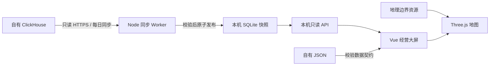

# 架构

前端负责展示、日期与组织范围筛选、计算口径和地图交互，不持有源数据库密码。同步 Worker 负责源数据读取和完整性检查；只有成功版本才能成为当前快照。读 API 始终读取已发布的本地版本。

## 目录职责

- `src/restaurant/model.mjs`：空值、渠道、日期窗口、加权单均和门店聚合。
- `src/restaurant/adapter.ts`：空模板、本地 API 和自有 JSON 的入口。
- `src/restaurant/components/StorePerformancePanel.vue`：门店前20名 CSS 循环滚动，不产生逐帧数据请求。
- `src/views/index/map3d/`：几何合并、场景资源复用、拾取及分辨率控制。
- `server/snapshot-source.mjs`：源表映射和批次读取模板。
- `server/snapshot-publish.mjs`：数据校验、SQLite 落盘和原子切换。
- `server/snapshot-service.mjs`：北京时间10:00调度、启动补同步、状态及失败恢复。
- `server/snapshot-reader.mjs`：按范围读取 SQLite，保持会员和订单去重口径。
- `server/clickhouse.mjs`：只读 SQL、HTTPS、资源和超时约束。

本仓库默认使用空模板。测试夹具由 `tests/fixtures/` 中代码人工构造，仅用于验证数学与接口行为，不会被前端加载或打包到静态业务数据文件。
